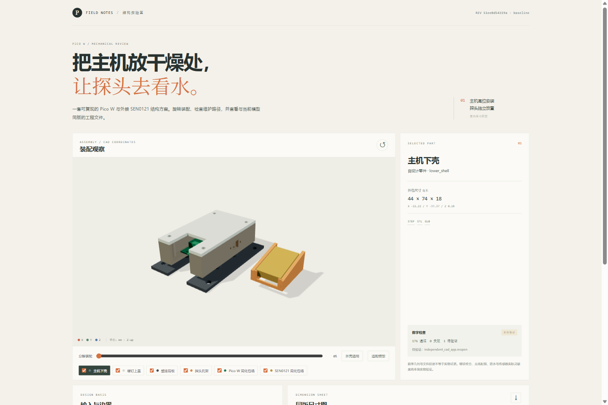

# Pico W Leak Sensor Enclosure

A parametric mechanical learning prototype for mounting a Raspberry Pi Pico W in a dry elevated location while placing a removable SEN0121 water-sensing board separately. The repository contains four custom enclosure parts for prototyping, simplified hardware envelopes, STEP/STL/GLB exports, digital geometry checks, a browser assembly viewer, and a parameter-derived dimension sheet.



## Reproduce

Use Python 3.12 and Node.js 22. From the repository root:

```powershell
python -m venv .venv
.\.venv\Scripts\python.exe -m pip install -r requirements-lock.txt
.\.venv\Scripts\python.exe scripts/prepare_viewer.py
.\.venv\Scripts\python.exe -m pytest -q
Set-Location viewer
npm ci
npm test
npm run build
npm run dev
```

Open the local Vite URL printed by `npm run dev`. `prepare_viewer.py` rebuilds the baseline, copies only files listed by its manifest into the viewer, and generates the SVG dimensions from the same parameters and manifest. No local absolute path is required.

## Engineering checks

The baseline report currently records **176 digital checks passed, 0 failed, and 1 unverified**. The unverified check is reopening the STEP files in an independent desktop CAD application. Tests also regenerate meaningful parameter variants and exercise deliberate invalid inputs and geometry intrusions. The GitHub Actions workflow is configured to run the geometry suite and production viewer build on Windows.

Digital STEP reimport and GLB coordinate checks do not establish physical fit or product reliability. No physical print/fit, fastening-strength, RF, alarm, sensing-depth, or waterproof test has been performed. The sensor connector is not waterproof; this is not a certified alarm or enclosure.

## Project files

- `cad/`: editable Python geometry, parameters, export and validation.
- `artifacts/baseline/`: current revision-matched STEP, STL, GLB, manifest and validation outputs.
- `viewer/`: Three.js review page and lockfile.
- `artifacts/drawings/pico-w-dimensions.svg`: generated dimension sheet.
- `docs/sources-and-assumptions.md`: public references, assumptions, installation sequence and limits.
- `docs/bom.md`: part inventory.

See [sources and assumptions](docs/sources-and-assumptions.md), [BOM](docs/bom.md), and [contributing](CONTRIBUTING.md). The viewer review page is responsive and includes model selection, visibility, explode, shell transparency, fit/reset controls, the actual validation status and same-version downloads.

## License and attribution

Original project code and design files are released under the MIT License. Manufacturer specifications are linked and attributed rather than redistributed. Raspberry Pi and DFRobot names identify compatible reference products and remain their respective owners' marks. See [LICENSE](LICENSE) and [sources and assumptions](docs/sources-and-assumptions.md).

Retain the [Three.js runtime license notice](viewer/public/licenses/third-party-notices.txt) when sharing the built viewer. Other dependencies keep their upstream licenses.
